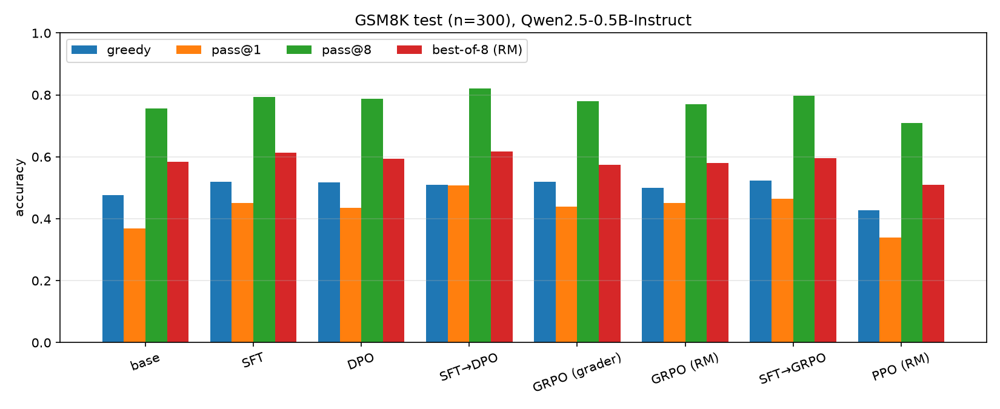
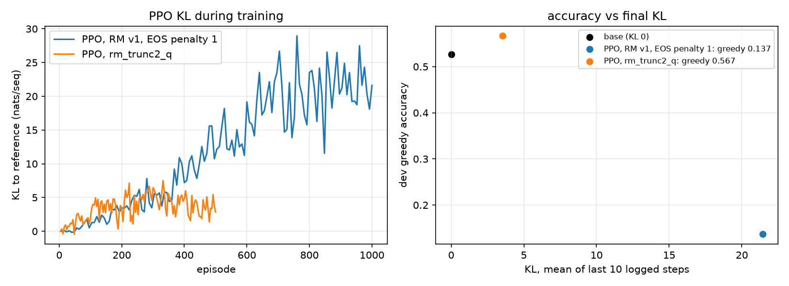

# LLM post-training ablation

Compares post-training methods on GSM8K with Qwen2.5-0.5B-Instruct on Apple Silicon:
SFT, DPO, GRPO, and RLHF with a learned reward model (GRPO or PPO). LoRA (rank 16)
is used unless `--full` is given.

All methods use the same correctness signal: an exact-match check of the final
number against the GSM8K answer (`common.is_correct`).

- SFT trains on correct answers sampled from the base model.
- DPO trains on (correct, incorrect) answer pairs for the same question.
- GRPO samples answers during training and uses the 0/1 grade as reward.
- The reward model is trained on the DPO pairs. GRPO and PPO can use it in place of the grader.

## Setup

Two virtual environments, because PPO needs an older TRL:

    python -m venv .venv && .venv/bin/pip install -r requirements.txt
    python -m venv .venv-ppo && .venv-ppo/bin/pip install -r requirements-ppo.txt

## Data

    .venv/bin/python prepare.py      # GSM8K -> data/prompts/{train,valid,dev,test}.jsonl
    .venv/bin/python build_data.py   # 8 base-model samples per prompt, graded -> data/sft, data/dpo

Splits: train 1000 and valid 100 are used to build training data. Dev (300, from
the GSM8K train set, disjoint from train/valid) is used to compare runs and
choose settings. Test (300, from the GSM8K test set) is evaluated once at the end.

## Training

    .venv/bin/python train_offline.py --method sft --name sft_lora
    .venv/bin/python train_offline.py --method dpo --name dpo_lora
    .venv/bin/python train_offline.py --method rm --name rm_trunc --trunc-neg
    .venv/bin/python train_grpo.py --name grpo
    .venv/bin/python train_grpo.py --name rlhf_grpo --reward-model checkpoints/rm_trunc
    .venv-ppo/bin/python train_ppo.py --reward-model checkpoints/rm_trunc/merged

Checkpoints are written to `checkpoints/<name>`. `--init <merged dir>` starts a
run from an earlier one (for example SFT followed by DPO).

`--trunc-neg` adds pairs in which a complete answer is preferred over the same
answer cut short, with and without an end-of-sequence token. Without them the
reward model scores unfinished answers above finished ones, and PPO learns to
stop emitting EOS.

`configs/*.yaml` and `rewards.py` are for training SFT, DPO and GRPO with
mlx-lm-lora instead of TRL. Those adapters are written to `adapters/` and are
evaluated with `evaluate.py --adapter`.

## Evaluation

    .venv/bin/python merge.py checkpoints/sft_lora                # -> checkpoints/sft_lora/merged
    .venv/bin/python merge.py checkpoints/rm_trunc --seq-cls      # reward model
    .venv/bin/python evaluate.py --name sft_lora_dev --model checkpoints/sft_lora/merged
    .venv/bin/python evaluate.py --name base_dev
    .venv/bin/python compare.py base_dev sft_lora_dev

`evaluate.py` generates one greedy answer and 8 sampled answers (temperature
0.8) per dev question and writes `results/<name>.json` and
`results/<name>.samples.jsonl`. Reported metrics: greedy accuracy, mean accuracy
of the sampled answers, pass@k (Chen et al. 2021), mean answer length in tokens,
and the fraction of answers that hit the token limit. `--split test` evaluates
on the test set.

`compare.py` computes the difference between two runs with a 95% bootstrap
interval. It resamples questions, not individual answers, and uses the same
resampled questions for both runs.

Reward-model diagnostics:

    .venv/bin/python probe_rm.py checkpoints/rm/merged checkpoints/rm_trunc/merged
    .venv/bin/python bon_rm.py checkpoints/rm_trunc/merged

`probe_rm.py` checks whether a reward model scores truncated answers above
complete ones. `bon_rm.py` measures the accuracy obtained by letting the reward
model choose one of the 8 stored samples per question (best-of-8).

Tables and plots for the results below:

    .venv/bin/python bon_rm.py checkpoints/rm_trunc2/merged --policy sft_lora --split dev
    .venv/bin/python summarize.py --split dev     # -> results/summary_dev.md, results/plots/

## Results

Qwen2.5-0.5B-Instruct, LoRA rank 16, one seed per method, n=300 questions per split.
Greedy is one deterministic answer per question. pass@1 is the mean accuracy of 8
answers sampled at temperature 0.8; pass@8 is the fraction of questions where at
least one of the 8 is correct. Best-of-8 (RM) is the accuracy when the reward model
`rm_trunc2` picks one of the 8 samples. Δ columns are differences from the base
model on the same questions, with 95% paired bootstrap intervals over questions
(`compare.py`).

Methods: SFT on correct base-model samples; DPO (lr 5e-6) on correct/incorrect
pairs; SFT→DPO is DPO started from the merged SFT model; GRPO with the exact-match
grader as reward; GRPO (RM) with the learned reward model as reward; SFT→GRPO is
grader-reward GRPO started from SFT; PPO (RM) with `rm_trunc2`.

### Dev (used to choose settings)

| method | greedy | Δ greedy vs base [95% CI] | pass@1 | Δ pass@1 vs base [95% CI] | pass@8 | best-of-8 (RM) |
|---|---|---|---|---|---|---|
| base | 0.527 | – | 0.444 | – | 0.827 | 0.697 |
| SFT | 0.587 | +0.060 [+0.010, +0.110] | 0.549 | +0.105 [+0.081, +0.129] | 0.893 | 0.753 |
| DPO | 0.607 | +0.080 [+0.027, +0.137] | 0.529 | +0.085 [+0.061, +0.109] | 0.870 | 0.680 |
| SFT→DPO | 0.627 | +0.100 [+0.040, +0.160] | 0.613 | +0.169 [+0.141, +0.197] | 0.910 | 0.753 |
| GRPO (grader) | 0.593 | +0.067 [+0.017, +0.120] | 0.522 | +0.078 [+0.055, +0.102] | 0.867 | 0.683 |
| GRPO (RM) | 0.630 | +0.103 [+0.050, +0.160] | 0.545 | +0.101 [+0.077, +0.126] | 0.860 | 0.710 |
| SFT→GRPO | 0.630 | +0.103 [+0.050, +0.157] | 0.564 | +0.120 [+0.095, +0.145] | 0.893 | 0.750 |
| PPO (RM) | 0.567 | +0.040 [-0.023, +0.107] | 0.435 | -0.009 [-0.034, +0.016] | 0.827 | 0.663 |

### Test (read once, no selection on it)

| method | greedy | Δ greedy vs base [95% CI] | pass@1 | Δ pass@1 vs base [95% CI] | pass@8 | best-of-8 (RM) |
|---|---|---|---|---|---|---|
| base | 0.477 | – | 0.368 | – | 0.757 | 0.583 |
| SFT | 0.520 | +0.043 [-0.010, +0.097] | 0.452 | +0.084 [+0.060, +0.107] | 0.793 | 0.613 |
| DPO | 0.517 | +0.040 [-0.013, +0.090] | 0.435 | +0.067 [+0.043, +0.090] | 0.787 | 0.593 |
| SFT→DPO | 0.510 | +0.033 [-0.027, +0.090] | 0.508 | +0.140 [+0.115, +0.165] | 0.820 | 0.617 |
| GRPO (grader) | 0.520 | +0.043 [-0.010, +0.097] | 0.439 | +0.071 [+0.049, +0.094] | 0.780 | 0.573 |
| GRPO (RM) | 0.500 | +0.023 [-0.030, +0.077] | 0.450 | +0.083 [+0.057, +0.108] | 0.770 | 0.580 |
| SFT→GRPO | 0.523 | +0.047 [-0.010, +0.103] | 0.465 | +0.098 [+0.072, +0.122] | 0.797 | 0.597 |
| PPO (RM) | 0.427 | -0.050 [-0.110, +0.007] | 0.339 | -0.029 [-0.053, -0.005] | 0.710 | 0.510 |

### Findings

- Every method except PPO raises pass@1 over the base model on both splits, by
  +0.07 to +0.14 on test. The intervals exclude zero.
- SFT→DPO has the highest pass@1 on dev and test (+0.140 on test). Starting from
  the SFT model raises pass@1 over the same method started from base, paired on the
  same questions: DPO +0.074 [+0.051, +0.097] and GRPO +0.026 [+0.003, +0.049] on
  test (+0.084 and +0.042 on dev). Greedy shows no difference (both within ±0.06).
- Greedy accuracy rises by +0.02 to +0.05 on test, but no interval excludes zero.
  On dev the same methods gain +0.06 to +0.10. At n=300 the greedy metric cannot
  separate the methods from each other; pass@1, which averages 8 samples per
  question, can.
- Reward-model reranking (best-of-8) adds +0.11 to +0.22 over pass@1 for every
  policy. The gain is largest for the base model (+0.215 on test) and smallest for
  SFT→DPO (+0.108). Best-of-8 stays well below pass@8, so the
  reward model picks a wrong answer on many questions that have a correct one.
- PPO did not improve on the base model. The first run (reward model without
  truncated-answer pairs, EOS penalty 1) drifted to KL ≈ 21 and greedy accuracy
  0.137: the reward model scored unfinished answers above finished ones and PPO
  learned to stop emitting EOS. With `rm_trunc2` the KL stayed near 3.5 and the
  policy stayed near the base model on dev (greedy 0.567, pass@1 0.435) and
  fell slightly below it on test (pass@1 -0.029 [-0.053, -0.005]).

### Merge bug (fixed)

`merge.py` used to merge every LoRA adapter onto the hub base model. For SFT→DPO
and SFT→GRPO the adapter was trained on top of `checkpoints/sft_lora/merged`, so
the merged model silently dropped the SFT update (on one layer the merged weights
differed from base by 9.5e-5, while SFT differs from base by 8.5e-4). It now merges
onto the adapter's recorded `base_model_name_or_path`. The earlier SFT→DPO dev
result (greedy 0.617, pass@1 0.580) came from the wrong merge and is kept only as
`results/sftdpo_lr5e6_wrongbase_dev.json`.

### Limitations

- n=300 questions per split: a ±0.05 interval on greedy accuracy, so differences
  between methods below about 0.05 are not resolved.
- One seed per method. Seed variance is not measured, and some of the dev-to-test
  differences in ranking may be seed noise.
- 0.5B model, LoRA only, short runs sized to fit beside other work on one laptop
  (SFT→GRPO: 250 steps, 2 prompts × 8 samples, 300 tokens, GPU memory capped at 8 GB).
- Settings were chosen on dev, so dev numbers are optimistic; test is the
  unbiased read.

### Future work

- Longer PPO with KL snapshots along the run, to trace accuracy against KL.
- Full fine-tuning instead of LoRA.
- GRPO with `rm_trunc2` as reward.
- Full rejection-sampling pipeline: best-of-8 with the reward model to build SFT data.
