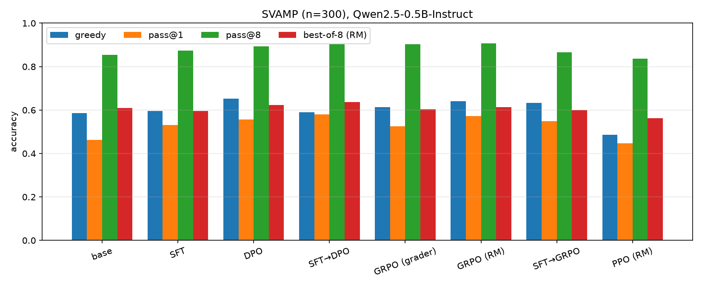
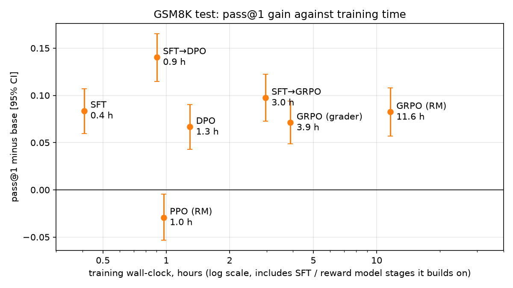
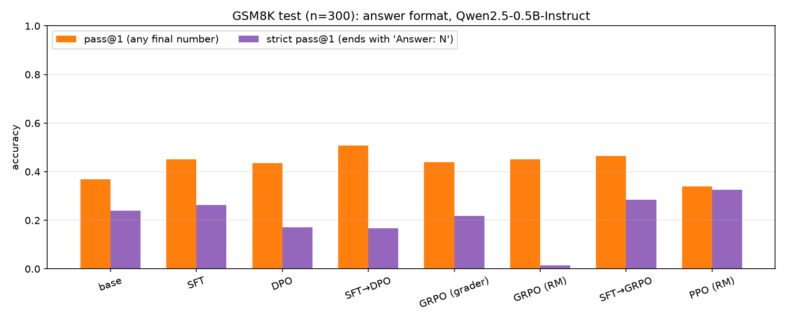

# Teaching math to a small LLM with post-training

This project tries to teach a small language model grade-school math. The model
is Qwen2.5-0.5B-Instruct, the problems are GSM8K word problems, and all training
runs on one Apple Silicon laptop. Before training, the model's greedy answer is
correct on 0.477 of the test problems, and 0.368 of its sampled answers are
correct.

The project uses only post-training, with two ingredients: the model's own
sampled answers, and a checker that compares the final number with the GSM8K
answer key. The method comparison uses no stronger teacher model and no
written solutions; a separate experiment ([Training on written
solutions](#training-on-written-solutions)) tests what written solutions add.
The questions are how much math the model learns this way, whether the gain holds
on problems it never trained on, and which post-training method teaches it best.
Every method gets the same model, data and checker:

- **SFT**: fine-tune on the model's own correct answers.
- **DPO**: train on (correct, incorrect) answer pairs for the same question.
- **GRPO**: online RL; sample answers during training, reward 1 if correct, 0 if not.
- **RLHF with a learned reward model**: a reward model is trained on the DPO
  pairs, then used as the reward for GRPO or PPO in place of the checker.
- **Combinations**: DPO and GRPO started from the SFT model (SFT→DPO, SFT→GRPO).

## What the model learned

Test split, 300 GSM8K problems never used for training or for choosing settings.
Intervals are 95% paired bootstrap intervals over questions.

- Every method except PPO raises pass@1, the mean accuracy of 8 sampled answers.
  SFT→DPO raises it most, from 0.368 to 0.508 (+0.140 [+0.115, +0.165]).
- The gain holds on SVAMP, a second set of math word problems that was not used
  for training or selection. pass@1 rises by +0.062 to +0.117 for every method
  except PPO, and SFT→DPO is again highest.
- Greedy accuracy rises less, by +0.023 to +0.047 on test, and no interval
  excludes zero at n=300.
- pass@8 (at least one of 8 samples correct) rises significantly only for
  SFT→DPO, from 0.757 to 0.820. Depending on the method, 69% to 82% of the pass@1
  gain comes from questions where at least one of the base model's 8 samples was
  already correct. So post-training here seems to make the model more reliable on
  problems it could already solve some of the time, more than it teaches it to
  solve new ones. The experiments do not isolate this, and with 8 samples
  "could already solve" is itself measured with noise.
- Some methods stop writing the requested `Answer: <number>` line. Counting only
  answers that have it, SFT→DPO falls below base, and PPO and SFT→GRPO score
  highest (see Answer format below).

Comparing the methods:

- Starting from SFT helps. DPO and GRPO started from the SFT model beat the same
  methods started from base on pass@1 (test: DPO +0.074 [+0.051, +0.097],
  GRPO +0.026 [+0.003, +0.049]).
- SFT→DPO has the highest pass@1 on dev, test and SVAMP. On top of SFT, DPO
  adds +0.057 [+0.034, +0.080] test pass@1 (SVAMP +0.048 [+0.022, +0.073]), and
  GRPO adds +0.014 [-0.010, +0.037]. On test, no method improves greedy accuracy
  over SFT.
- Plain SFT on the model's own correct answers trains in 0.4 h and raises test
  pass@1 by +0.084, 60% of the SFT→DPO gain.
- PPO with a learned reward model did not beat base. The first reward model
  scored truncated answers above complete ones, so PPO learned to stop before
  finishing. A reward model trained with truncated-answer pairs fixed the
  truncation, and PPO still did not beat base.

All results are one seed per method with short LoRA runs; see Limitations.

## Approach

All methods use the same correctness signal: an exact-match check of the final
number against the GSM8K answer (`is_correct` in `posttrain/common.py`).
Training data comes from the base model itself: 8 sampled answers per training
question, graded by that check.

- SFT trains on the correct base-model answers.
- DPO trains on (correct, incorrect) pairs for the same question.
- GRPO samples during training and uses the 0/1 grade as reward.
- The reward model is trained on the DPO pairs; GRPO and PPO can use it in place
  of the grader.

LoRA (rank 16) is used unless `--full` is given.

Splits: train 1000 and valid 100 are used to build training data. Dev (300, from
the GSM8K train set, disjoint from train/valid) is used to compare runs and
choose settings. Test (300, from the GSM8K test set) is evaluated once at the
end. SVAMP (300 problems, a different set of math word problems) is used only to
test whether the gains carry over.

Metrics: greedy is one deterministic answer per question. pass@1 is the mean
accuracy of 8 answers sampled at temperature 0.8; pass@8 is the fraction of
questions where at least one of the 8 is correct. Best-of-8 (RM) is the accuracy
when the reward model `rm_trunc2` picks one of the 8 samples.

## Results

Qwen2.5-0.5B-Instruct, LoRA rank 16, one seed per method, n=300 questions per
split. All differences are paired: both models answer the same questions, and the
95% interval comes from resampling questions (`compare.py`, 10,000 draws).

Methods: SFT on correct base-model samples; DPO (lr 5e-6) on correct/incorrect
pairs; SFT→DPO is DPO started from the merged SFT model; GRPO with the exact-match
grader as reward; GRPO (RM) with reward model v1 as reward; SFT→GRPO is
grader-reward GRPO started from SFT; PPO (RM) with `rm_trunc2_q` as reward.
Reward model v1 is trained on the DPO pairs only. `rm_trunc2` and `rm_trunc2_q`
also get the truncated-answer pairs and differ only in training length (2 and
0.5 epochs).

### Accuracy by method

pass@1 (orange) rises over base for every method except PPO, on GSM8K test and on
SVAMP. Greedy (blue) and pass@8 (green) move less; most of those differences have
95% intervals that cross zero (see All tables).

### What each method adds on top of SFT

Paired differences against the SFT model. DPO started from SFT
adds +0.057 [+0.034, +0.080] pass@1 on test and +0.048 [+0.022, +0.073] on SVAMP.
GRPO started from SFT adds +0.014 [-0.010, +0.037] on test. On test, no method
improves greedy accuracy over SFT. DPO, GRPO and GRPO (RM) started from base are
level with SFT on test pass@1 (intervals include zero) and took longer to train
(1.3 to 10.8 h, against 0.4 h for SFT; see Wall-clock).

### Training time against result

Each point is a method's test pass@1 minus base, with its 95% interval, against
its training time. The time includes the stages a method builds on: SFT for
SFT→DPO and SFT→GRPO, the reward model for GRPO (RM) and PPO. It leaves out
sampling the base-model answers that SFT, DPO and the reward models train on.
SFT→DPO gives the largest gain in under an hour. SFT alone reaches about the same
gain as DPO, GRPO (grader) and GRPO (RM) in a third to a thirtieth of their time.
All runs shared one laptop with other jobs, so the times are rough (see
Wall-clock).

### Answer format

The prompt asks for a final line `Answer: <number>`. pass@1 (orange) accepts the
last number in the answer when that line is missing; strict pass@1 (purple)
counts only complete answers that end with the line and are correct. DPO,
SFT→DPO and GRPO (RM) write the line less often than base, so their strict pass@1
falls below base. PPO and SFT→GRPO have the highest strict pass@1. Within each
method except PPO and GRPO (RM), answers with and without the line are about
equally accurate (difference 0.00 to 0.05), so the pass@1 gains do not come from
the fallback parser.

### PPO

The first PPO run used reward model v1, which scores truncated answers above
complete ones (`probe_rm.py`). KL reached about 21, 90% of dev answers hit the
token limit, and dev greedy accuracy fell to 0.137. With `rm_trunc2_q` KL stayed
near 3.5 and 0.5% of answers hit the limit, but pass@1 did not beat base (test
-0.029 [-0.053, -0.005]).

### Training on written solutions

Every SFT run above trains on the model's own correct answers. Two extra runs
train on written solutions to the same 1,000 training questions instead, with
the same SFT settings (LoRA, lr 1e-4, 2 epochs):

- **GSM8K references** (`sft_gold`): the dataset's own solutions, which are terse
  (51 words on average) and skip explanation.
- **Teacher solutions** (`sft_teacher`): step-by-step solutions written by Claude
  for this project, about 100 words each. Each states the goal, numbers the steps,
  says why each step is taken, and ends with a check. Example:

      We need the total cost of replacing Tom's floor.
      Step 1. Find the area of the room, because area is length times width: 8 x 7 = 56 square feet.
      Step 2. Find the cost of the new floor, because it costs $1.25 per square foot: 56 x 1.25 = $70.
      Step 3. Add the $50 cost of removing the old floor: 70 + 50 = $120.
      Check: 120 - 50 = 70, and 70 / 56 = 1.25 dollars per square foot, which matches the price.
      Answer: 120

Test differences against base (paired, 95% intervals):

| Training data | greedy | pass@1 | pass@8 | answer length |
|---|---|---|---|---|
| Own correct answers (SFT) | +0.043 [-0.010, +0.097] | +0.084 [+0.060, +0.107] | +0.037 [-0.007, +0.080] | 155 words |
| Teacher solutions | -0.087 [-0.153, -0.023] | -0.042 [-0.072, -0.014] | -0.080 [-0.133, -0.027] | 100 words |
| GSM8K references | -0.143 [-0.210, -0.077] | -0.090 [-0.118, -0.062] | -0.070 [-0.123, -0.017] | 52 words |

Both kinds of written solution make the model worse than base. Teacher solutions
are better than the GSM8K references (pass@1 +0.048 [+0.022, +0.075]) but
0.126 below own-answer SFT. Both raise strict pass@1, because every written
solution ends with the `Answer:` line.

The model copies the form of the written solutions more than the reasoning. Its
answers take on their length (100 and 52 words, against 153 for base), and 298 of
300 teacher-trained greedy answers end with a check. The checks do not catch
errors: none of the 183 wrong greedy answers has a check that reports a problem.
Most checks redo the previous step backwards (`6 x 5 = 30, and 30 / 5 = 6, which
matches`) or state agreement after a mismatch. Own-answer SFT keeps the model's
own style and reinforces only its correct answers; written solutions ask a 0.5B
model to adopt a new style at the same time. This matches Li et al. (2025) (see
Related work).

A dev run of GSM8K-reference SFT at a lower learning rate (2e-5, 1 epoch) gave
the same drop (pass@1 -0.099 [-0.127, -0.072] against base), so a too-large update
is an unlikely cause. One configuration was run on the teacher solutions; a
template that varies, or corrections that keep the model's wording, may do better
(see Future work).

Writing the solutions turned up GSM8K label errors in the 1,100 training and
validation questions. For example, "double a number and add 5, that's 20 more than
half the number" is labelled 4 (the answer is 10), and a two-hive honey problem is
labelled 2460 (the answer is 1060). Fourteen questions with wrong labels or labels
that need a strained reading were dropped from the teacher data; they are listed
in `check_teacher.py`. The own-answer SFT and DPO data still include them.

### All tables

Full tables for test, dev and SVAMP, answer format, wall-clock, and detailed findings

For best-of-8, `bon_rm.py` saves whether the picked sample is correct for each
question, and `compare.py` bootstraps that difference the same way.

#### Test (read once, no selection on it)

| method | greedy | Δ greedy vs base [95% CI] | pass@1 | Δ pass@1 vs base [95% CI] | pass@8 | Δ pass@8 vs base [95% CI] | best-of-8 (RM) | Δ best-of-8 vs base [95% CI] |
|---|---|---|---|---|---|---|---|---|
| base | 0.477 |  | 0.368 |  | 0.757 |  | 0.583 |  |
| SFT | 0.520 | +0.043 [-0.010, +0.097] | 0.452 | +0.084 [+0.060, +0.107] | 0.793 | +0.037 [-0.007, +0.080] | 0.613 | +0.030 [-0.023, +0.083] |
| DPO | 0.517 | +0.040 [-0.013, +0.090] | 0.435 | +0.067 [+0.043, +0.090] | 0.787 | +0.030 [-0.017, +0.073] | 0.593 | +0.010 [-0.047, +0.067] |
| SFT→DPO | 0.510 | +0.033 [-0.027, +0.090] | 0.508 | +0.140 [+0.115, +0.165] | 0.820 | +0.063 [+0.020, +0.107] | 0.617 | +0.033 [-0.020, +0.087] |
| GRPO (grader) | 0.520 | +0.043 [-0.010, +0.097] | 0.439 | +0.071 [+0.049, +0.094] | 0.780 | +0.023 [-0.023, +0.067] | 0.573 | -0.010 [-0.060, +0.040] |
| GRPO (RM) | 0.500 | +0.023 [-0.030, +0.077] | 0.450 | +0.083 [+0.057, +0.108] | 0.770 | +0.013 [-0.030, +0.057] | 0.580 | -0.003 [-0.057, +0.050] |
| SFT→GRPO | 0.523 | +0.047 [-0.010, +0.103] | 0.465 | +0.098 [+0.072, +0.122] | 0.797 | +0.040 [-0.007, +0.083] | 0.597 | +0.013 [-0.037, +0.063] |
| PPO (RM) | 0.427 | -0.050 [-0.110, +0.007] | 0.339 | -0.029 [-0.053, -0.005] | 0.710 | -0.047 [-0.100, +0.007] | 0.510 | -0.073 [-0.130, -0.017] |

#### Dev (used to choose settings)

| method | greedy | Δ greedy vs base [95% CI] | pass@1 | Δ pass@1 vs base [95% CI] | pass@8 | Δ pass@8 vs base [95% CI] | best-of-8 (RM) | Δ best-of-8 vs base [95% CI] |
|---|---|---|---|---|---|---|---|---|
| base | 0.527 |  | 0.444 |  | 0.827 |  | 0.697 |  |
| SFT | 0.587 | +0.060 [+0.010, +0.110] | 0.549 | +0.105 [+0.081, +0.129] | 0.893 | +0.067 [+0.030, +0.103] | 0.753 | +0.057 [+0.007, +0.107] |
| DPO | 0.607 | +0.080 [+0.027, +0.137] | 0.529 | +0.085 [+0.061, +0.109] | 0.870 | +0.043 [+0.010, +0.077] | 0.680 | -0.017 [-0.070, +0.037] |
| SFT→DPO | 0.627 | +0.100 [+0.040, +0.160] | 0.613 | +0.169 [+0.141, +0.197] | 0.910 | +0.083 [+0.050, +0.117] | 0.753 | +0.057 [+0.007, +0.110] |
| GRPO (grader) | 0.593 | +0.067 [+0.017, +0.120] | 0.522 | +0.078 [+0.055, +0.102] | 0.867 | +0.040 [+0.003, +0.077] | 0.683 | -0.013 [-0.067, +0.040] |
| GRPO (RM) | 0.630 | +0.103 [+0.050, +0.160] | 0.545 | +0.101 [+0.077, +0.126] | 0.860 | +0.033 [+0.000, +0.067] | 0.710 | +0.013 [-0.040, +0.067] |
| SFT→GRPO | 0.630 | +0.103 [+0.050, +0.157] | 0.564 | +0.120 [+0.095, +0.145] | 0.893 | +0.067 [+0.030, +0.103] | 0.750 | +0.053 [+0.000, +0.107] |
| PPO (RM) | 0.567 | +0.040 [-0.023, +0.107] | 0.435 | -0.009 [-0.034, +0.016] | 0.827 | +0.000 [-0.040, +0.040] | 0.663 | -0.033 [-0.083, +0.017] |

#### Transfer: SVAMP (not used for training or selection)

SVAMP test split, 300 problems (`prepare_transfer.py`), same prompt, grader and
sampling as above. SVAMP was added after the GSM8K results were known; no setting
was chosen on it.

| method | greedy | Δ greedy vs base [95% CI] | pass@1 | Δ pass@1 vs base [95% CI] | pass@8 | Δ pass@8 vs base [95% CI] | best-of-8 (RM) | Δ best-of-8 vs base [95% CI] |
|---|---|---|---|---|---|---|---|---|
| base | 0.587 |  | 0.463 |  | 0.853 |  | 0.610 |  |
| SFT | 0.597 | +0.010 [-0.043, +0.063] | 0.532 | +0.069 [+0.044, +0.095] | 0.873 | +0.020 [-0.020, +0.060] | 0.597 | -0.013 [-0.070, +0.043] |
| DPO | 0.653 | +0.067 [+0.013, +0.120] | 0.556 | +0.093 [+0.068, +0.118] | 0.893 | +0.040 [-0.003, +0.083] | 0.623 | +0.013 [-0.043, +0.067] |
| SFT→DPO | 0.590 | +0.003 [-0.053, +0.060] | 0.580 | +0.117 [+0.089, +0.144] | 0.903 | +0.050 [+0.007, +0.093] | 0.637 | +0.027 [-0.023, +0.080] |
| GRPO (grader) | 0.613 | +0.027 [-0.027, +0.083] | 0.525 | +0.062 [+0.039, +0.086] | 0.903 | +0.050 [+0.010, +0.090] | 0.603 | -0.007 [-0.060, +0.043] |
| GRPO (RM) | 0.640 | +0.053 [-0.007, +0.110] | 0.572 | +0.109 [+0.084, +0.133] | 0.907 | +0.053 [+0.013, +0.097] | 0.613 | +0.003 [-0.050, +0.057] |
| SFT→GRPO | 0.633 | +0.047 [-0.007, +0.103] | 0.548 | +0.085 [+0.059, +0.112] | 0.867 | +0.013 [-0.033, +0.057] | 0.600 | -0.010 [-0.060, +0.040] |
| PPO (RM) | 0.487 | -0.100 [-0.157, -0.043] | 0.446 | -0.017 [-0.041, +0.008] | 0.837 | -0.017 [-0.060, +0.027] | 0.563 | -0.047 [-0.100, +0.007] |

- pass@1 vs base: every method except PPO is higher, intervals excluding zero,
  +0.062 to +0.117. SFT→DPO is again highest. Paired differences on SVAMP:
  SFT→DPO minus SFT→GRPO +0.031 [+0.006, +0.058]; SFT→DPO minus DPO +0.024
  [+0.000, +0.048]; SFT→GRPO minus GRPO +0.023 [-0.001, +0.048].
- PPO greedy is below base by 0.100 [-0.157, -0.043].
- Best-of-8 (RM) minus pass@1 is +0.042 to +0.147, smaller than on GSM8K test
  (+0.108 to +0.215); the GRPO (RM) interval includes zero (+0.042 [-0.003, +0.084]).
  Best-of-8 is 0.24 to 0.30 below pass@8.
- Answer format follows the GSM8K pattern: GRPO (RM) tags 12% of answers (strict
  pass@1 0.074 vs base 0.313), PPO tags 94% (`results/summary_svamp.md`).

#### Findings

- pass@1 vs base: all methods except PPO are higher on both splits, with
  intervals excluding zero. Range on test: +0.067 (DPO) to +0.140 (SFT→DPO).
- SFT initialisation: DPO and GRPO started from the SFT model have higher pass@1
  than the same methods started from base. Paired differences on test: DPO +0.074
  [+0.051, +0.097], GRPO +0.026 [+0.003, +0.049] (dev: +0.084, +0.042). Greedy
  differences: DPO -0.007 [-0.060, +0.047], GRPO +0.003 [-0.053, +0.060].
- SFT→DPO has the highest pass@1 on both splits. Paired difference to the next
  method, SFT→GRPO: test +0.043 [+0.021, +0.064], dev +0.049 [+0.027, +0.072].
  Greedy difference: test -0.013 [-0.070, +0.043].
- Greedy vs base: +0.023 to +0.047 on test, no interval excludes zero. Dev:
  +0.060 to +0.103. The greedy intervals are about ±0.05 wide, compared with about
  ±0.025 for pass@1, which averages 8 samples per question.
- pass@8 vs base on test: only SFT→DPO has an interval excluding zero, +0.063
  [+0.020, +0.107]. The others are -0.047 (PPO) to +0.040, intervals including zero.
- Best-of-8 (RM) vs base on test: -0.010 to +0.033 for every method except PPO,
  all intervals including zero; PPO is -0.073 [-0.130, -0.017]. On dev only the
  three SFT-initialised arms exclude zero (+0.053 to +0.057). Best-of-8 on the base
  model (test 0.583) is above the pass@1 of every trained model (at most 0.508).
- Best-of-8 (RM) minus pass@1: +0.108 (SFT→DPO) to +0.215 (base) on test,
  +0.140 to +0.253 on dev. Best-of-8 is 0.17 to 0.21 below pass@8 on test. On
  that share of questions at least one sample is correct and the reward model
  picks an incorrect one.
- PPO: no improvement over base. The first run (reward model without truncated-answer
  pairs, EOS penalty 1) reached KL ≈ 21; dev greedy accuracy was 0.137 and 90% of
  answers hit the token limit (base: 2%). `probe_rm.py` shows that this reward model
  scores truncated answers above complete ones. With `rm_trunc2_q` the KL was about
  3.5 and 0.5% of answers hit the limit. Dev: greedy 0.567, pass@1 0.435 (pass@1
  vs base -0.009 [-0.034, +0.016]). Test: pass@1 vs base -0.029 [-0.053, -0.005].

#### Answer format (test)

The prompt asks for a final line `Answer: <number>`. The grader takes the last
`Answer:` value, or the last number in the text if the tag is missing, so the
pass@1 above counts untagged answers. Each sampled answer is classed as
truncated (reaches 512 tokens), tagged, or untagged. Strict pass@1 counts only
complete, tagged, correct answers. Produced by `summarize.py`.

| method | truncated | tagged | untagged | acc. tagged | acc. untagged | pass@1 | strict pass@1 | Δ strict pass@1 vs base [95% CI] |
|---|---|---|---|---|---|---|---|---|
| base | 0.029 | 0.613 | 0.358 | 0.392 | 0.353 | 0.368 | 0.240 |  |
| SFT | 0.033 | 0.545 | 0.421 | 0.483 | 0.444 | 0.452 | 0.263 | +0.023 [+0.000, +0.046] |
| DPO | 0.057 | 0.372 | 0.571 | 0.461 | 0.460 | 0.435 | 0.172 | -0.068 [-0.093, -0.044] |
| SFT→DPO | 0.030 | 0.311 | 0.659 | 0.535 | 0.518 | 0.508 | 0.167 | -0.073 [-0.101, -0.047] |
| GRPO (grader) | 0.042 | 0.452 | 0.506 | 0.482 | 0.432 | 0.439 | 0.218 | -0.022 [-0.047, +0.001] |
| GRPO (RM) | 0.059 | 0.035 | 0.906 | 0.393 | 0.479 | 0.450 | 0.014 | -0.226 [-0.253, -0.200] |
| SFT→GRPO | 0.023 | 0.590 | 0.387 | 0.483 | 0.463 | 0.465 | 0.285 | +0.045 [+0.021, +0.069] |
| PPO (RM) | 0.007 | 0.926 | 0.067 | 0.351 | 0.199 | 0.339 | 0.325 | +0.085 [+0.061, +0.110] |

- Within each method except PPO and GRPO (RM), tagged and untagged answers
  differ in accuracy by 0.00 to 0.05, so the pass@1 gains are not explained by
  the fallback parser. GRPO (RM) tags too few answers (3.5%) to compare.
- DPO, SFT→DPO and GRPO (RM) tag fewer answers than base. GRPO (RM) tags 3.5%.
  Under strict parsing SFT→DPO (0.167) is below base (0.240), and the highest
  strict pass@1 is PPO (0.325), followed by SFT→GRPO (0.285).
- Strict pass@1 vs base on test, paired intervals: above base PPO +0.085
  [+0.061, +0.110], SFT→GRPO +0.045 [+0.021, +0.069], SFT +0.023 [+0.000, +0.046];
  below base DPO -0.068 [-0.093, -0.044], SFT→DPO -0.073 [-0.101, -0.047], GRPO (RM)
  -0.226 [-0.253, -0.200]; GRPO (grader) -0.022 [-0.047, +0.001].
- The grader reward used by GRPO and SFT→GRPO is `is_correct`, which accepts
  untagged answers. DPO and reward-model pairs are chosen by correctness only.
  None of these training signals rewards the tag directly.
- Dev shows the same pattern (`results/summary_dev.md`).

#### Wall-clock

Training time from the TRL logs (`train_runtime`; for PPO, first to last write of
the log). All runs were on one M3 Max laptop that also ran unrelated jobs, so
these are measured times, not controlled throughput. The three GRPO runs each
generated about 4,000 completions (500 prompts × 8). SFT trained on 1,507 correct
base-model answers for 2 epochs, DPO and SFT→DPO on 1,295 pairs for 1 epoch, PPO
for 500 episodes.

| arm | training (h) | dev eval (min) |
|---|---|---|
| SFT | 0.41 | 9.2 |
| DPO | 1.29 | 14.8 |
| SFT→DPO | 0.49 | 15.0 |
| GRPO (grader) | 3.89 | 16.0 |
| GRPO (RM) | 10.84 | 132.8 |
| SFT→GRPO | 2.55 | 12.0 |
| PPO (RM) | 0.47 | 6.2 |
| reward model v1 | 0.75 | |
| reward model `rm_trunc2` | 2.04 | |
| reward model `rm_trunc2_q` | 0.51 | |

The GRPO (RM) training and dev eval times are high relative to the other arms
and overlapped with other jobs on the machine; their share of contention was not
measured. DPO and SFT→DPO trained on the same number of pairs and differ by 2.6×
in time; contention is the likely cause but was not measured either.

### Merge bug (fixed)

`merge.py` used to merge every LoRA adapter onto the hub base model. For SFT→DPO
and SFT→GRPO the adapter was trained on top of `checkpoints/sft_lora/merged`, so
the merged model did not contain the SFT update (on one layer the merged weights
differed from base by 9.5e-5, while SFT differs from base by 8.5e-4). It now merges
onto the adapter's recorded `base_model_name_or_path`. The earlier SFT→DPO dev
result (greedy 0.617, pass@1 0.580) came from the wrong merge and is kept only as
`results/sftdpo_lr5e6_wrongbase_dev.json`.

## Related work

Is a 0.5B model too small for RL methods such as GRPO to help beyond SFT? The
papers below do not say size alone rules it out. They do predict the pattern seen
here.

- RL mostly sharpens what the base model can already do. Yue et al. (2025) find
  that RL-trained models beat their base model at pass@1 but not at pass@k for
  large k, and that the correct answers RL produces are already among the base
  model's samples. Here pass@1 rises for every method except PPO, while pass@8
  moves little. On test, each method solves 24 to 32 questions that base never
  solves in 8 samples. Each also fails 13 to 20 questions that base does solve;
  PPO solves 25 base misses and fails 39 base solves. With 8 samples per question,
  part of this swap is sampling noise.
- Training on the model's own correct answers is a strong baseline. The SFT here
  is rejection-sampling fine-tuning (RFT, Yuan et al. 2023; STaR, Zelikman et al.
  2022). It trains on the base model's correct samples, not on the GSM8K
  reference solutions. Like every method here it trains a LoRA adapter. Xiong et al. (2025) find RAFT, the same idea run online, competitive with
  GRPO and PPO on math. GRPO's advantage there comes mainly from discarding prompts
  where every sample is wrong. Yuan et al. also find RFT helps weaker models more.
  SFT matching GRPO here fits both.
- What RL can amplify depends on the base model. Gandhi et al. (2025) trace RL
  gains to behaviours the base model already shows, such as checking its work and
  backtracking. Under the same RL, Qwen-2.5-3B has them and improves; Llama-3.2-3B
  lacks them and does not. A 0.5B model likely shows fewer of these behaviours.
- Small models learn reasoning better by imitation. DeepSeek-R1 (DeepSeek-AI 2025)
  reports that distilling a large reasoning model into small models beats running
  RL on the small models directly. Li et al. (2025) find that models of 3B and
  below learn better from short reasoning chains than from long ones or from a
  much larger teacher. The written-solution runs above fit this.
- RL from the base model does work at this size. SimpleRL-Zoo (Zeng et al. 2025)
  runs it on every Qwen2.5 size from 0.5B to 32B, with many more prompts and steps
  than here.
- LoRA is unlikely to be the limit. Schulman et al. (2025, "LoRA Without Regret")
  find that even rank-1 LoRA matches full fine-tuning for RL, at a learning rate
  about 10 times the best full-fine-tuning one.

Model size may be part of the answer, but these runs do not show it. A more direct
cause is visible in the GRPO logs: the runs barely moved the policy. Each saw 500
of the 1,000 training questions once (250 steps × 2 prompts × 8 samples) at
learning rate 5e-6, which was not tuned. (DPO was tuned on dev: at 5e-5 it
collapsed to 0.30 greedy, at 5e-6 it reached 0.607.) KL to the
starting model stayed at about 0.006 for GRPO (grader) and 0.002 for SFT→GRPO.
Training reward went from 0.43 in the first fifth of steps to 0.48 in the last.
For about a quarter of the prompts, all 8 samples got the same grade, which
gives no gradient. Telling the two causes apart needs a GRPO run that does move
(a higher LoRA learning rate, more prompts), repeated on Qwen2.5-1.5B.

References:

- Yue et al. 2025, Does Reinforcement Learning Really Incentivize Reasoning Capacity in LLMs Beyond the Base Model? [arXiv:2504.13837](https://arxiv.org/abs/2504.13837)
- Yuan et al. 2023, Scaling Relationship on Learning Mathematical Reasoning with Large Language Models. [arXiv:2308.01825](https://arxiv.org/abs/2308.01825)
- Zelikman et al. 2022, STaR: Bootstrapping Reasoning With Reasoning. [arXiv:2203.14465](https://arxiv.org/abs/2203.14465)
- Xiong et al. 2025, A Minimalist Approach to LLM Reasoning: from Rejection Sampling to Reinforce. [arXiv:2504.11343](https://arxiv.org/abs/2504.11343)
- Gandhi et al. 2025, Cognitive Behaviors that Enable Self-Improving Reasoners. [arXiv:2503.01307](https://arxiv.org/abs/2503.01307)
- DeepSeek-AI 2025, DeepSeek-R1. [arXiv:2501.12948](https://arxiv.org/abs/2501.12948)
- Li et al. 2025, Small Models Struggle to Learn from Strong Reasoners. [arXiv:2502.12143](https://arxiv.org/abs/2502.12143)
- Zeng et al. 2025, SimpleRL-Zoo. [arXiv:2503.18892](https://arxiv.org/abs/2503.18892)
- Schulman et al. 2025, LoRA Without Regret. [thinkingmachines.ai/blog/lora](https://thinkingmachines.ai/blog/lora/)

## Limitations

- n=300 questions per split. Greedy differences below about 0.05 are not resolved.
  MDE not computed.
- One seed per method. Seed variance is not measured; dev-to-test changes in
  ranking cannot be attributed to the method or to the seed.
- 0.5B model, LoRA only, short runs that fit beside other jobs on one laptop
  (SFT→GRPO: 250 steps, 2 prompts × 8 samples, 300 tokens, GPU memory capped at 8 GB).
- All training data and reward-model pairs are sampled from the base model, one
  round only. The model never trains on its own improved answers.
- Settings were chosen on dev, so dev numbers are biased upward. Test was read once,
  after all settings were fixed.
- Intervals are per comparison, with no correction for the 7 comparisons against
  base per metric, or for the 5 metrics per comparison.
- The best-of-8 reward model `rm_trunc2` and the PPO reward `rm_trunc2_q` are
  trained on the same pairs, sampled from the base model.
- The written solutions come from a much stronger model (Claude) and follow one
  fixed template. One SFT configuration was run on them (the same settings as
  own-answer SFT), so the result bounds that configuration only.
- GRPO (RM) used reward model v1, which scores truncated answers above complete
  ones (`probe_rm.py`). GRPO (RM) has the highest truncation rate on test (0.059).

## Future work

Toward teaching the model more math:

- Several rounds of sample → grade → train (expert iteration), so later rounds
  learn from the improved model's answers rather than only from the base model's.
- Full rejection-sampling pipeline: best-of-8 with the reward model to build SFT data.
- Full fine-tuning instead of LoRA.

- Written solutions that keep the model's own wording: take its wrong answers
  and fix only the broken step, so training corrects mistakes without changing
  the style (see Training on written solutions).
- Written solutions mixed with the model's own correct answers, and written
  solutions only for the questions the base model never solves.

Toward a cleaner method comparison:

- GRPO tuned until it moves the policy: a learning-rate sweep (5e-6, 1e-5,
  2e-5, 5e-5) checked on dev and KL, all 1,000 training questions, then the same recipe on Qwen2.5-1.5B, to test whether
  model size limits RL here (see Related work).

- More seeds per method, to separate method from seed.
- Longer PPO with KL snapshots along the run, to trace accuracy against KL.
- GRPO with `rm_trunc2` as reward.

## Reproducing

### Repository layout

    posttrain/
      common.py, generation.py   prompt, grader, file helpers; batched sampling with mlx-lm
      prep/      prepare.py (GSM8K splits), prepare_transfer.py (SVAMP), build_data.py (SFT and DPO data),
                 build_gold.py and check_teacher.py (SFT data from written solutions)
      train/     offline.py (SFT, DPO, reward model), grpo.py, ppo.py, merge.py (LoRA -> full checkpoint)
      eval/      evaluate.py, compare.py (paired bootstrap), bon_rm.py (best-of-8), probe_rm.py
      report/    summarize.py (tables and figures for this README)
    mlx/         alternative SFT, DPO and GRPO training with mlx-lm-lora (configs and reward)
    results/     evaluation summaries, summary tables and plots

Every script runs as a module from the repository root, e.g.
`.venv/bin/python -m posttrain.eval.evaluate --help`. `data/`, `checkpoints/`,
`logs/` and `adapters/` are created by the scripts and not committed.

### Setup

Two virtual environments, because PPO needs an older TRL:

    python -m venv .venv && .venv/bin/pip install -r requirements.txt
    python -m venv .venv-ppo && .venv-ppo/bin/pip install -r requirements-ppo.txt

### Data

    .venv/bin/python -m posttrain.prep.prepare      # GSM8K -> data/prompts/{train,valid,dev,test}.jsonl
    .venv/bin/python -m posttrain.prep.build_data   # 8 base-model samples per prompt, graded -> data/sft, data/dpo
    .venv/bin/python -m posttrain.prep.build_gold   # GSM8K reference solutions -> data/sft_gold
    .venv/bin/python -m posttrain.prep.check_teacher  # written solutions, checked -> data/sft_teacher

The written solutions are in `data/sft_teacher/batches/out_*.txt`;
`check_teacher.py` keeps those whose final answer matches GSM8K and lists the
questions dropped for wrong GSM8K labels.

### Training

Commands for the runs reported above (each output must be merged with
`merge.py` before it is used as `--init` or as a reward model):

    .venv/bin/python -m posttrain.train.offline --method sft --name sft_lora
    .venv/bin/python -m posttrain.train.offline --method sft --name sft_gold --sft-data sft_gold
    .venv/bin/python -m posttrain.train.offline --method sft --name sft_teacher --sft-data sft_teacher
    .venv/bin/python -m posttrain.train.offline --method dpo --name dpo_lr5e6 --lr 5e-6
    .venv/bin/python -m posttrain.train.offline --method dpo --name sftdpo_lr5e6 --lr 5e-6 --init checkpoints/sft_lora/merged
    .venv/bin/python -m posttrain.train.offline --method rm --name rm    # reward model v1
    .venv/bin/python -m posttrain.train.offline --method rm --name rm_trunc2 --trunc-neg --epochs 2
    .venv/bin/python -m posttrain.train.offline --method rm --name rm_trunc2_q --trunc-neg --epochs 0.5
    .venv/bin/python -m posttrain.train.grpo --name grpo
    .venv/bin/python -m posttrain.train.grpo --name rlhf_grpo --reward-model checkpoints/rm/merged
    .venv/bin/python -m posttrain.train.grpo --name sftgrpo --init checkpoints/sft_lora/merged --max-tokens 300 --grad-accum 4
    .venv-ppo/bin/python -m posttrain.train.ppo --reward-model checkpoints/rm_trunc2_q/merged --out checkpoints/ppo_rmtrunc_small \
        --episodes 500 --batch-size 4 --response-length 300 --missing-eos-penalty 1

Checkpoints are written to `checkpoints/<name>`. `--init <merged dir>` starts a
run from an earlier one.

`--trunc-neg` adds pairs in which a complete answer is preferred over the same
answer cut short, with and without an end-of-sequence token. Without them the
reward model scores unfinished answers above finished ones, and PPO learns to
stop emitting EOS.

`mlx/configs/*.yaml` and `mlx/rewards.py` are for training SFT, DPO and GRPO with
mlx-lm-lora instead of TRL. Those adapters are written to `adapters/` and are
evaluated with `evaluate.py --adapter`.

### Evaluation

    .venv/bin/python -m posttrain.train.merge checkpoints/sft_lora                # -> checkpoints/sft_lora/merged
    .venv/bin/python -m posttrain.train.merge checkpoints/rm_trunc --seq-cls      # reward model
    .venv/bin/python -m posttrain.eval.evaluate --name sft_lora_dev --model checkpoints/sft_lora/merged
    .venv/bin/python -m posttrain.eval.evaluate --name base_dev
    .venv/bin/python -m posttrain.eval.compare base_dev sft_lora_dev

`evaluate.py` generates one greedy answer and 8 sampled answers (temperature
0.8) per question and writes `results/<name>.json` and
`results/<name>.samples.jsonl`. Reported metrics: greedy accuracy, mean accuracy
of the sampled answers, pass@k (Chen et al. 2021), mean answer length in tokens,
and the fraction of answers that hit the token limit. `--split test` evaluates
on the test set.

`compare.py` computes the difference between two runs with a 95% bootstrap
interval. It resamples questions, not individual answers, and uses the same
resampled questions for both runs.

Reward-model diagnostics:

    .venv/bin/python -m posttrain.eval.probe_rm checkpoints/rm/merged checkpoints/rm_trunc2/merged
    .venv/bin/python -m posttrain.eval.bon_rm checkpoints/rm_trunc2/merged

`probe_rm.py` checks whether a reward model scores truncated answers above
complete ones. `bon_rm.py` measures the accuracy obtained by letting the reward
model choose one of the 8 stored samples per question (best-of-8).

Tables and plots:

    .venv/bin/python -m posttrain.eval.bon_rm checkpoints/rm_trunc2/merged --policy sft_lora --split dev
    .venv/bin/python -m posttrain.report.summarize --split dev     # -> results/summary_dev.md, results/plots/
    .venv/bin/python -m posttrain.report.summarize --split test    # also writes plots/format_test.png
    .venv/bin/python -m posttrain.report.summarize --split svamp

Transfer set:

    .venv/bin/python -m posttrain.prep.prepare_transfer          # SVAMP test -> data/prompts/svamp.jsonl
    .venv/bin/python -m posttrain.eval.evaluate --name sft_lora_svamp --model checkpoints/sft_lora/merged --split svamp
    .venv/bin/python -m posttrain.eval.bon_rm checkpoints/rm_trunc2/merged --policy sft_lora --split svamp
    .venv/bin/python -m posttrain.report.summarize --split svamp
